

# LeafDoc

**A $50 smartphone instrument for backlit field leaf imaging and AI plant-health diagnosis.**

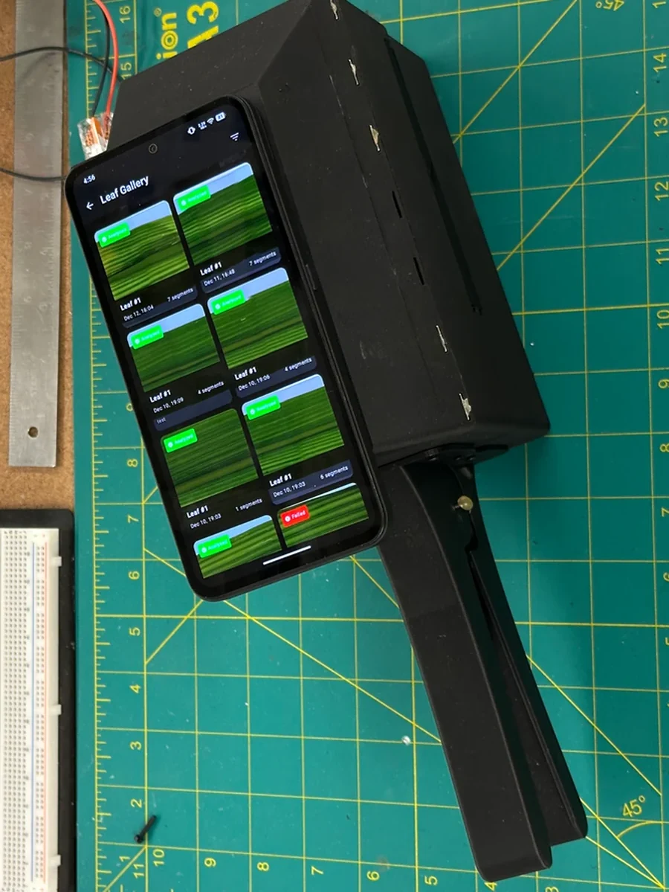

*Purdue ABE · 3D-printed hardware + Android app · deployed in a Purdue–DARPA field study (6,500+ captures) · next-generation LeafStudio lightbox in build*

> **Project showcase.** This repository documents what LeafDoc does and how it was designed and built. The app source code and the hardware CAD are private. For collaboration or a demo, [get in touch](https://charleswang435.github.io).

---

## Why build it

Field photos of leaves are hard to score consistently. Lighting changes with the sun and clouds, the camera angle changes with every shot, and the symptoms that matter most, such as interveinal chlorosis, water-soaked lesions and mesophyll damage, are often ambiguous on the leaf surface.

LeafDoc fixes the geometry and the light. A handheld enclosure clamps over the leaf and backlights it, so the phone captures it in **transmittance**: light passing *through* the blade. Internal damage that is hard to see in a reflected-light photo becomes clearly visible, and every image in a trial is taken at the same distance, angle and illumination. The app then tags, stitches and diagnoses the images, so what leaves the phone is a usable scientific record rather than a snapshot.

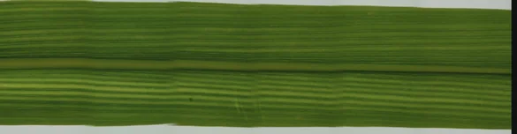
 One corn leaf, six backlit frames stitched into a continuous strip

---

## Build log

### 1. A fixed, backlit imaging geometry
A spring-loaded clamp holds the leaf flat against a backlit window, and the phone mounts on top so its camera looks straight down onto the lit blade. A leaf longer than the window is drawn through the slot section by section, and the app captures each section as a frame.

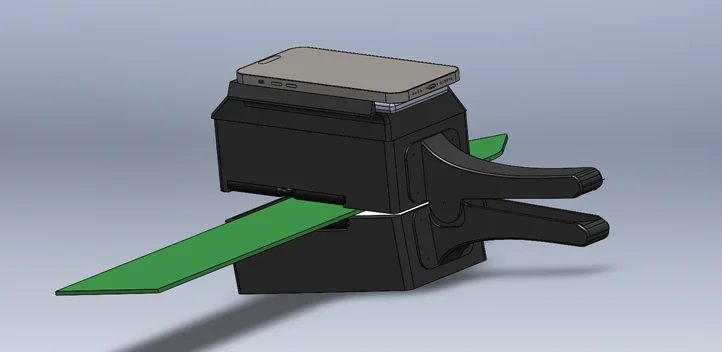

### 2. Iterating the enclosure
The enclosure went through several print revisions before settling on the clamp-and-handle design used in the field.

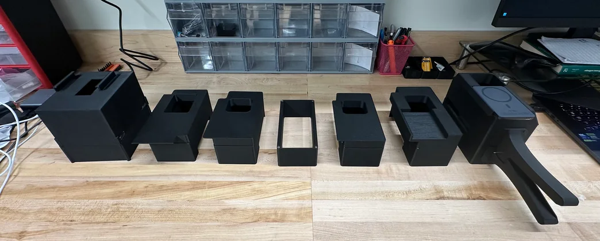

### 3. An app built for data, not photos
The Android app (Kotlin, Jetpack Compose, CameraX + Camera2) turns the phone into a manual instrument:

- **Manual camera control:** ISO, shutter, exposure compensation, white balance, zoom-based lens selection (0.6× to telephoto), five focus modes with AF lock, live histogram and grids, and full-sensor maximum-resolution capture where the phone allows it.
- **Lossless formats:** maximum-quality JPEG, PNG, TIFF from a hand-written encoder with no third-party dependency, and RAW/DNG from the sensor. Android can't decode TIFF or DNG, so the app previews a JPEG proxy and exports the original byte-for-byte.
- **Structured metadata:** farmer, field, treatment and leaf number on every capture, reusable pick lists, and automatic GPS.
- **Two field workflows:** *Simple* mode for one image per leaf with an always-visible metadata bar, and *Detailed* mode for multi-frame specimens kept un-stitched so the original frames stay the record.
- **Stitching:** horizontal panoramas with gradient blending and optional midrib alignment, which finds the leaf vein and corrects vertical drift between frames.

<table><tr>
<td align="center">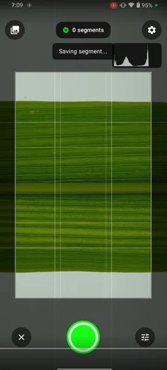 Backlit capture with live histogram</td>
<td align="center">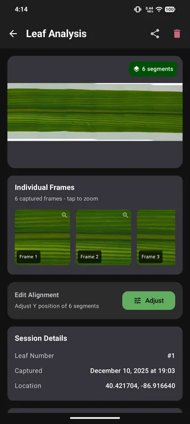 Stitched result and source frames</td>
<td align="center">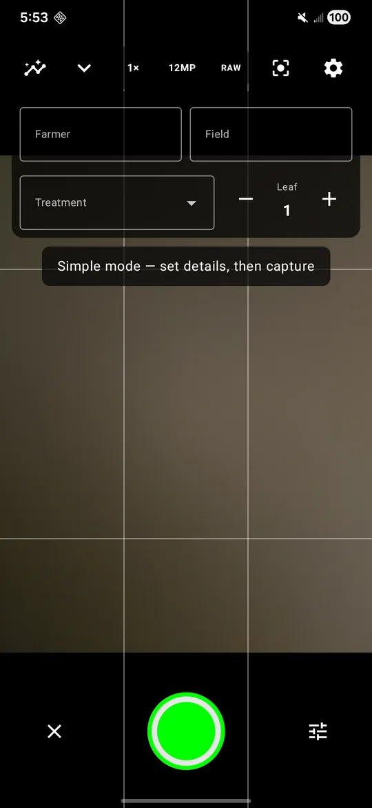 Simple or detailed sessions</td>
</tr><tr>
<td align="center">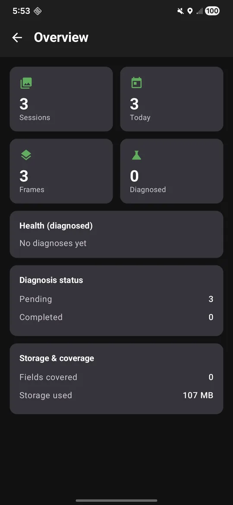 Overview dashboard</td>
<td align="center">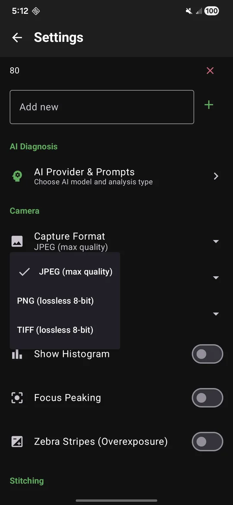 Capture formats</td>
<td align="center">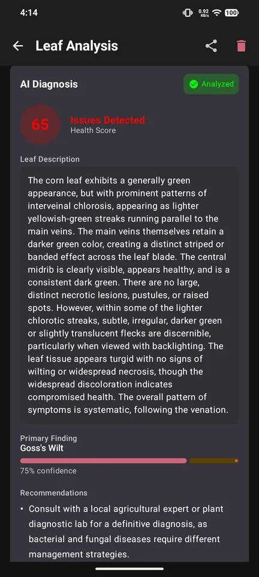 AI diagnosis</td>
</tr></table>

### 4. AI diagnosis that compares across models
Diagnosis runs through a provider-agnostic layer, so the vision model (Google Gemini, Anthropic Claude or OpenAI) is a setting rather than a rebuild. Four prompt templates, from a quick check to a research-grade report, are written specifically for transmittance imagery and share one JSON output contract. Every result has the same shape (health score, primary diagnosis with confidence, per-disease probabilities, treatment notes), so results can be compared across models and templates.

### 5. In the field
LeafDoc was deployed in a Purdue–DARPA study, collecting more than 6,500 captures.

---

## Next: the LeafStudio lightbox

**LeafStudio** (formerly LeafSpec RGB) is the second-generation enclosure, in build as Proto 1 (November 2026). Instead of a slot the leaf is drawn through, it is a light-tight box that gives any smartphone a controlled "studio" for a whole leaf section.

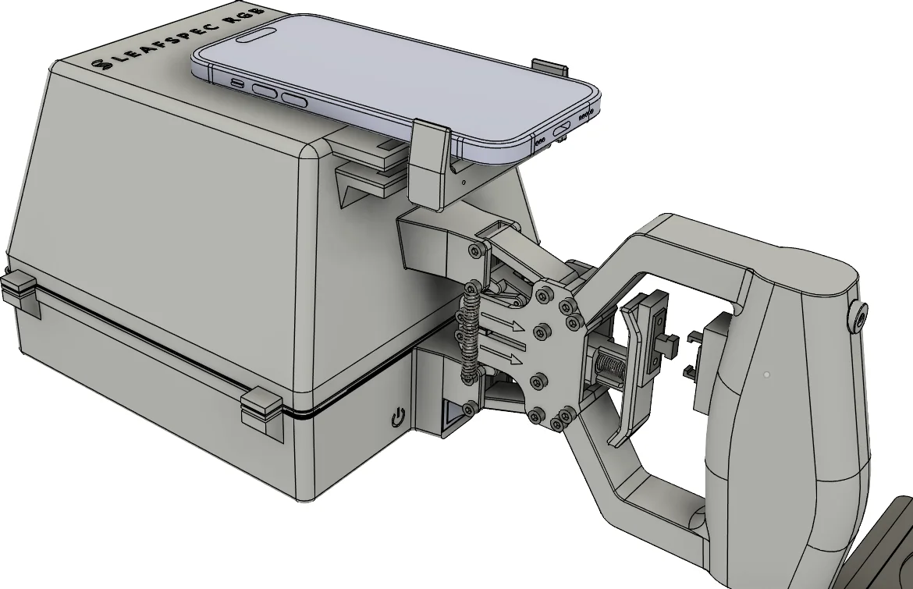

- **Light-tight box** with a backlit, diffused 15 × 15 cm window; the phone lies flat on the lid and looks straight down through it.
- **High-CRI lighting:** eleven rows of 4000 K, CRI 90 COB LED strip under an opal diffuser, powered from a battery in the handle.
- **Lights only when it matters:** the LEDs switch on only when the power is on *and* the box is closed, which saves battery and keeps ambient light out of every capture.
- **One-handed operation:** pulling the spring-loaded handle lifts the lid straight up on a parallelogram linkage, and a push-push latch holds it open for loading.
- **Adjustable phone mount:** a spring clamp on a sliding shuttle lines up any phone's camera with the window.
- Printed in carbon-fibre PLA, with a felt-and-magnet rim seal to block stray light.

<table><tr>
<td align="center">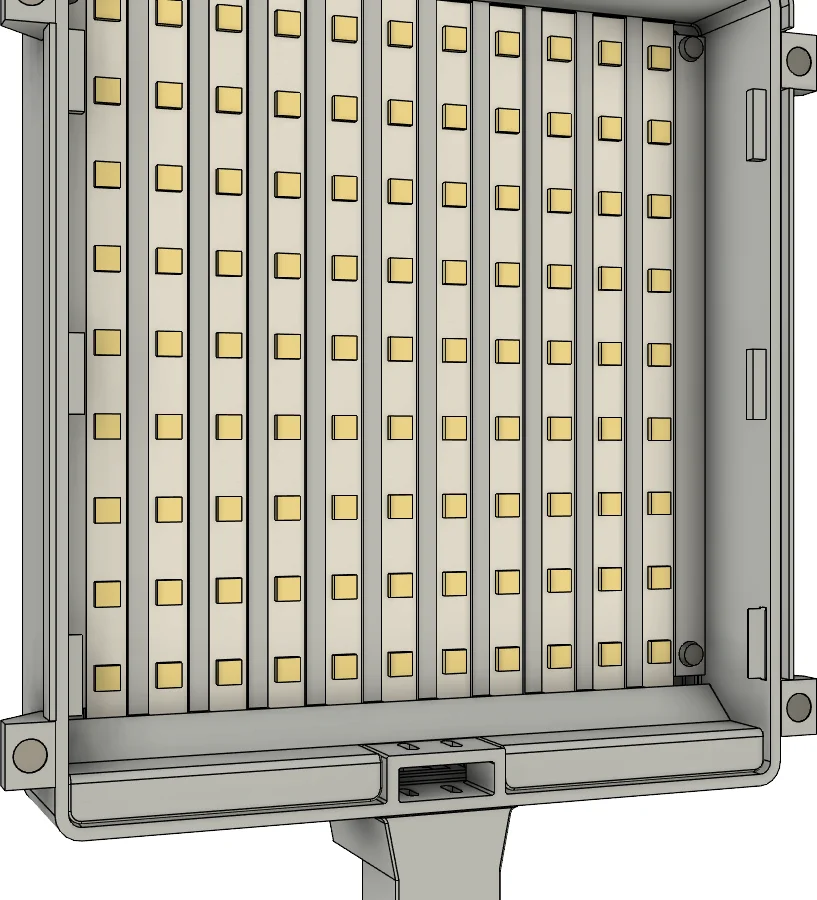 LED plate</td>
<td align="center">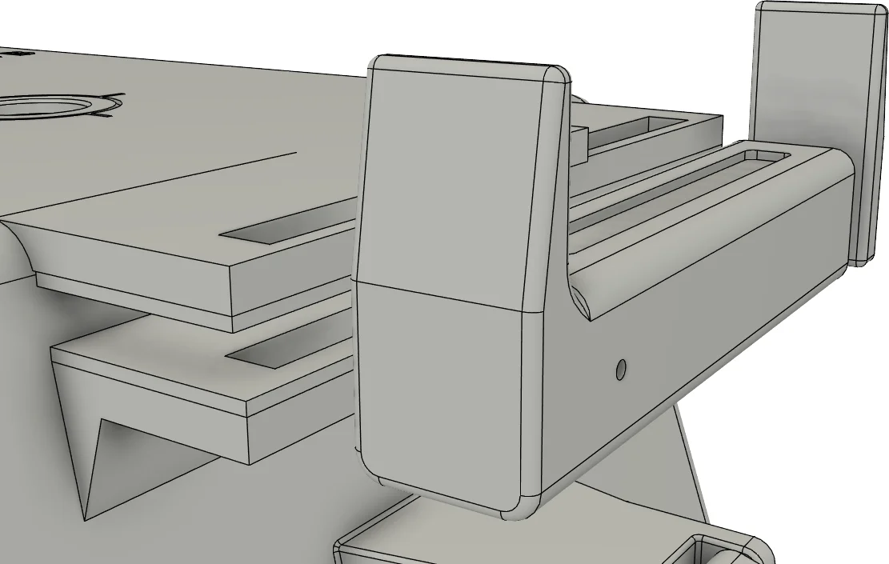 Phone clamp shuttle</td>
<td align="center">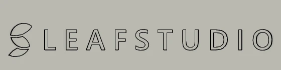 Lid wordmark</td>
</tr></table>

---

## Tools and stack

| Area | Stack |
| --- | --- |
| Hardware | Autodesk Fusion CAD, FDM printing (PLA-CF), COB LED lighting, 9 V battery with boost converter |
| App | Kotlin, Jetpack Compose (Material 3), MVVM, Hilt, Room, DataStore, Coroutines and Flow |
| Camera | CameraX with Camera2 interop, max-resolution and RAW/DNG capture |
| AI | Provider-agnostic interface over Gemini, Claude and OpenAI vision APIs |

---

<a href="https://charleswang435.github.io">Portfolio</a> · <a href="https://github.com/CharlesWang435">GitHub</a>

